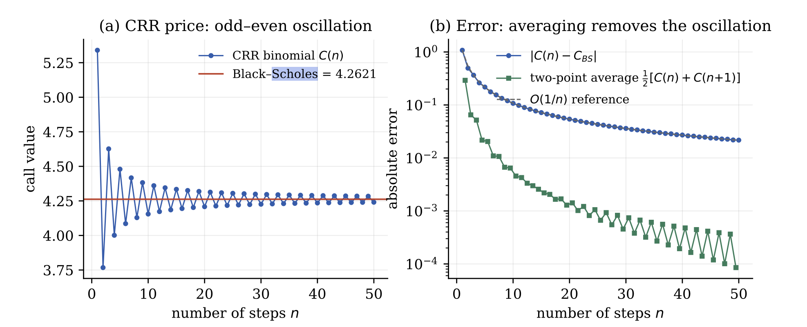
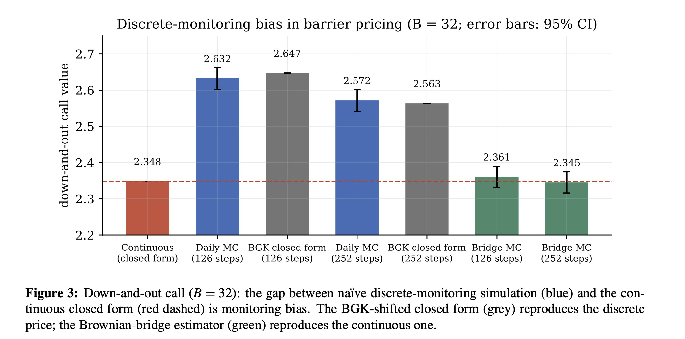

# Finance & Analytics Portfolio

I'm Mridul Macker, an MSc Finance graduate from Alliance Manchester Business School and a former Data & Insights Analyst at Axtria. This portfolio brings together my work in financial modelling, valuation, portfolio analysis and financial econometrics.

Each project links to its model, code or report, with the main findings explained below.

**Tools:** Python (NumPy, SciPy, pandas, statsmodels, arch) · Excel/VBA · Bloomberg Terminal · SQL

## Explore the projects

| Project | Main skills | Open |
| --- | --- | --- |
| Blu Containers: three-statement model | Forecasting, working capital, scenario analysis, Excel | [Project](./blu-containers-three-statement-model/) · [Excel](./blu-containers-three-statement-model/Blu_Containers_Three_Statement_Model.xlsx) · [PDF](./blu-containers-three-statement-model/Blu_Containers_Three_Statement_Model.pdf) |
| Rolls-Royce DCF valuation | Cash flow forecasting, WACC, valuation | [Excel model](./Rolls-Royce_DCF_Model.xlsx) |
| Active Portfolio Management | Portfolio construction, attribution, risk analysis | [Report](./Active%20Portfolio%20Management.pdf) |
| Derivatives pricing | Numerical methods, Monte Carlo, model validation, Python | [Project and code](./derivatives-pricing/) |
| Merck time series analysis | Econometrics, backtesting, volatility forecasting, Python | [Project and code](./merck-time-series-analysis/) |

## Projects

### Blu Containers — Three-Statement Financial Model

Integrated Excel model linking the income statement, balance sheet and cash flow statement, with three historical years and a five-year forecast. Includes driver-based revenue and cost forecasts, working capital, CAPEX, debt and interest schedules, and base/best/worst scenarios. The analysis highlights capacity constraints and the effect of pricing and cost inflation on profitability: 2027 net income is about $19m in the base case, $30m in the best case and $5m in the worst case. Completed using the CFA Institute Financial Modeling Practical Skills Module case study.

[View project](blu-containers-three-statement-model/README.md) · [Excel model](blu-containers-three-statement-model/Blu_Containers_Three_Statement_Model.xlsx) · [PDF](blu-containers-three-statement-model/Blu_Containers_Three_Statement_Model.pdf)

### 🔢 Derivatives Pricing

Priced European and American equity options using seven numerical methods in Python (full method list in the [project README](./derivatives-pricing/README.md)), including binomial trees, finite-difference PDE methods, Monte Carlo simulation, and Longstaff-Schwartz. Compared European option estimates with Black–Scholes and American option estimates with numerical benchmarks, reporting method-specific errors and Monte Carlo uncertainty. Diagnosed discrete-monitoring bias and the effects of volatility calibration.

[View project](./derivatives-pricing/)

### 💼 Active Portfolio Management (MSCI Europe)
Constructed and managed a €1bn active European equity portfolio against the MSCI Europe Index, applying multi-factor risk decomposition, Brinson attribution and Monte Carlo VaR. Over the six months from 31 December 2024 to 30 June 2025, the portfolio returned 8.47% against 9.09% for the benchmark (not annualised), at lower total risk and VaR than benchmark; Brinson attribution diagnosed the shortfall as allocation-driven, concentrated in Novo Nordisk, rather than a failure of risk control.

[View project](./Active%20Portfolio%20Management.pdf)

### 📊 Rolls Royce DCF Valuation
Built a discounted cash flow model projecting free cash flow growth from £3.3bn to £5.1bn over five years, calculating WACC via CAPM at 8.5%. Discounted projected cash flows and terminal value back to present value, arriving at an intrinsic value of 1,320p against a market price of 1,110p, a 19% upside supporting a Buy recommendation.

[View project](./Rolls-Royce_DCF_Model.xlsx)

### 📉 Merck (MRK) Time Series Analysis
Empirical time-series econometrics on 26 years of daily MRK equity data (2000–2025): tested return properties (stationarity, normality, white-noise), evaluated rolling-window ARMA/ARMA-GARCH trading strategies out-of-sample against passive and technical benchmarks net of transaction costs, and forecast the high-low price spread using Log-HAR and Log-ARMA models. The tested return strategies underperformed buy-and-hold in this sample, while spread-based volatility forecasts improved on an AR(1) benchmark.

[View project folder](./merck-time-series-analysis/)

## About me

MSc Finance graduate from Alliance Manchester Business School, University of Manchester, with postgraduate training in economics and previous analytics experience at Axtria. I use Excel, SQL and Python to investigate business performance, build financial models and communicate findings.

Sat the CFA Level I exam in November 2026; results pending.

[LinkedIn](https://www.linkedin.com/in/mridulmacker/)

## Project context

This portfolio includes academic research and training case studies. Blu Containers is a hypothetical company, and the valuation and portfolio results relate to the assumptions and periods used in each project. Coursework and training sources are identified in the relevant project documentation.
