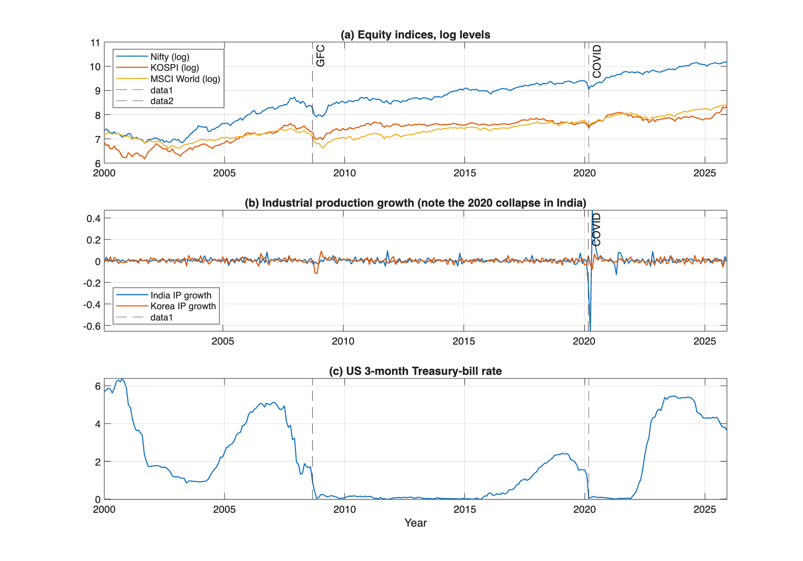
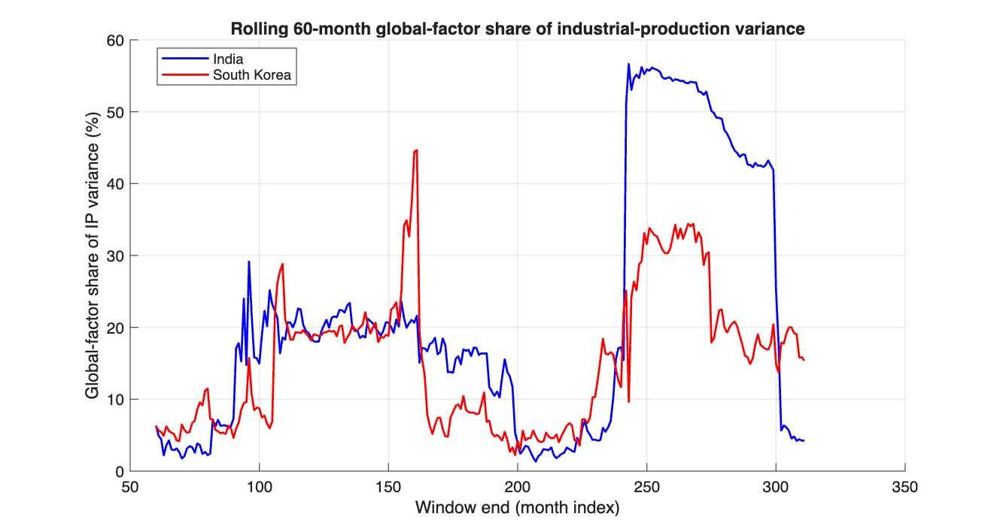
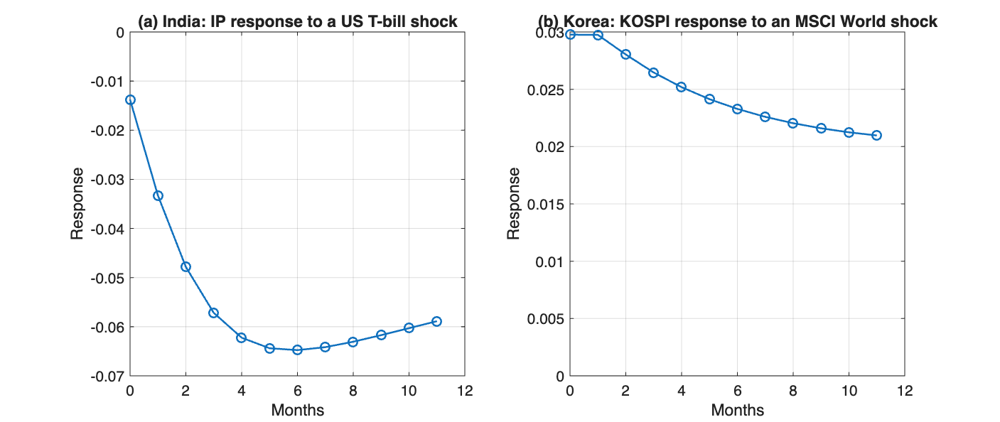
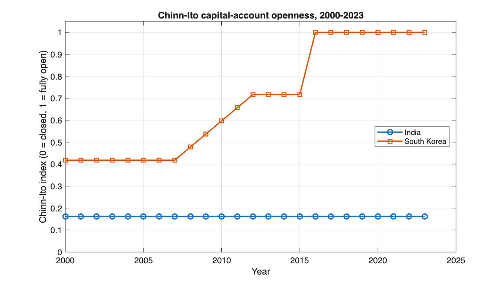

# Do Global Factors Dominate?

## Macroeconomic variables and stock returns in India and South Korea

**MSc Finance dissertation | Alliance Manchester Business School | MATLAB | Monthly data, 2000–2025**

How much of a market's exposure to global conditions can be explained by its formal financial openness? This dissertation compares India and South Korea using stock-market indices, industrial production, domestic macroeconomic controls and two global factors: MSCI World and the US three-month Treasury-bill rate.

**[Read the dissertation](paper/Mridul_Macker_Dissertation_India_South_Korea.pdf)** · **[Explore the MATLAB code](code/)** · **[Code and run guide](docs/CODE_GUIDE.md)** · **[Data sources](docs/DATA.md)**

### What the research finds

- **Global exposure depends on the channel and the sample.** Global factors matter in both countries, but their relative contribution changes with the response variable, specification and period examined.
- **Crisis observations can change the interpretation.** India's large full-sample global contribution to industrial-production variance becomes much smaller when the pandemic period is accounted for. The US T-bill contribution is particularly sensitive to these observations.
- **Stock markets contain information about subsequent real activity.** Predictive relationships from stock markets to industrial production are especially consistent across the Indian specifications, with less uniform evidence for Korea.
- **Formal openness does not give a stable exposure ranking.** The evidence does not establish that the more financially open country is consistently more exposed to global factors. The bootstrap interval for the India–Korea difference includes zero.

These are the dissertation's reported findings. Granger predictability, generalised impulse responses and variance decompositions do not establish structurally identified causal effects.

### Selected research outputs

*The underlying series illustrate the different market cycles and the exceptional movements in industrial production during COVID-19.*

*Archived 60-month rolling-window output. The horizontal axis is the window-end observation index; the contributions are normalised relative generalised FEVD shares, rather than structurally identified effects.*

More figures: impulse responses and financial openness

*Selected point-estimate response paths from the supplied plotting script. Confidence bands are not shown in this figure.*

*The openness series covers 2000–2023, a shorter period than the main analysis.*

### Research design

| Component | Approach |
| --- | --- |
| Markets | India: Nifty 50; South Korea: KOSPI |
| Real activity | Monthly industrial production |
| Domestic controls | Exchange rate, CPI, domestic interest rate and M3, entered in separate specifications |
| Global factors | MSCI World and the US three-month Treasury-bill rate |
| Stationarity | ADF tests, with KPSS checks for borderline series |
| Short-run dynamics | Country-specific VARs, lag selection and residual diagnostics |
| Long-run relationships | Johansen cointegration tests, VECMs and error-correction checks |
| Predictability and adjustment | Toda–Yamamoto tests and weak-exogeneity restrictions |
| Dynamic interpretation | Generalised impulse responses and normalised generalised FEVDs |
| Robustness | Alternative specifications, bootstrap inference, crisis sensitivity, structural-break checks and split samples |

### Files and use

| Location | Contents |
| --- | --- |
| [paper/](paper/) | Full 53-page dissertation; public cover identifies the author instead of the student ID |
| [code/](code/) | 41 supplied MATLAB scripts, including intermediate checks and historical aliases |
| [figures/](figures/) | Four original saved research figures |
| [docs/CODE_GUIDE.md](docs/CODE_GUIDE.md) | Script map, suggested entry points, dependencies and version notes |
| [docs/DATA.md](docs/DATA.md) | Sources, input schema and local data setup |
| [docs/PROVENANCE.md](docs/PROVENANCE.md) | Publication changes, duplicate files and archive status |

**Code status:** this is an accompanying research-code archive. The original CSV is not included, and MATLAB execution has not been revalidated for this publication. The guide distinguishes preparation, estimation and later corrections; running every file in filename order is not a supported workflow. Local MATLAB `.mat` dataset and result snapshots are excluded from the public package.

The analysis uses MATLAB and the Econometrics Toolbox. Some diagnostic functions also require the Statistics and Machine Learning Toolbox. Read the [code guide](docs/CODE_GUIDE.md) before running the scripts.

### Interpretation and limitations

This is a two-country study, and results are sensitive to crisis observations, model specification and cointegration assumptions. Generalised FEVD shares reflect correlated innovations and are normalised for comparison. Residual heteroskedasticity also limits the interpretation of some diagnostic and break tests. The dissertation discusses these qualifications in detail.

**Mridul Macker** · MSc Finance, University of Manchester · [LinkedIn](https://www.linkedin.com/in/mridulmacker/)
